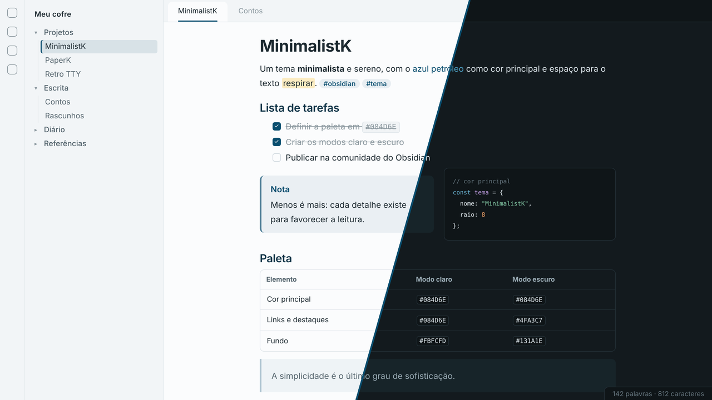
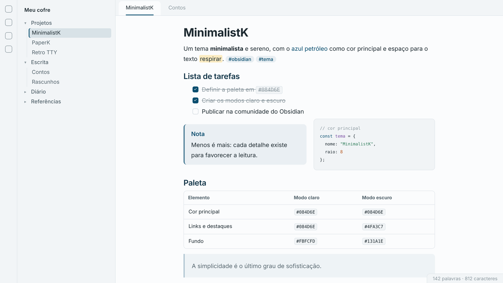
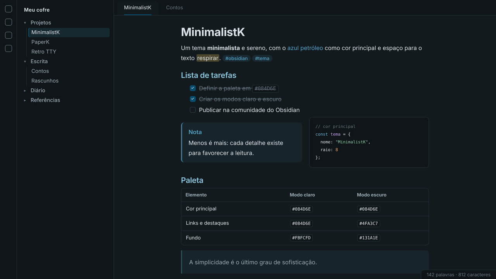

# MinimalistK

A clean, minimalist theme for [Obsidian](https://obsidian.md), built around **petroleum blue `#084D6E`**, with light and dark modes.

Tema minimalista e visualmente limpo para o Obsidian, com o **azul petróleo `#084D6E`** como cor principal e modos claro e escuro.

## English

- Calm bluish-grey palette, with petroleum blue on links, tags, checkboxes, primary buttons and list markers
- Light mode on soft white (`#FBFCFD`) and dark mode on bluish graphite (`#131A1E`)
- In dark mode, fills keep the pure petroleum blue while accent text uses a lighter shade of the same hue (`#4FA3C7`) for readability
- Sans-serif typography (Inter, IBM Plex Sans or the system font) and JetBrains Mono, Fira Code or equivalent for code
- Rounded tables, subtle blockquotes and callouts, thin underline on the active tab and a marker on the active file
- Custom syntax highlighting for both modes
- Options through the [Style Settings](https://github.com/mgmeyers/obsidian-style-settings) plugin: petroleum-blue headings, rule under H1, focus mode, line width and corner radius

## Português

### Características

- Paleta sóbria em tons de cinza azulado, com o azul petróleo em links, tags, caixas de seleção, botões principais e marcadores
- Modo claro em branco suave (`#FBFCFD`) e modo escuro em grafite azulado (`#131A1E`)
- No modo escuro, preenchimentos mantêm o azul petróleo puro e textos de destaque usam um tom mais claro do mesmo matiz (`#4FA3C7`), para garantir boa legibilidade
- Tipografia sem serifa (Inter, IBM Plex Sans ou a fonte do sistema) e código em JetBrains Mono, Fira Code ou equivalente
- Tabelas com cantos arredondados, citações e chamadas discretas, abas com sublinhado fino e arquivo ativo marcado na barra lateral
- Destaque de sintaxe próprio para os dois modos

### Modo claro

### Modo escuro

### Opções (plugin Style Settings)

| Opção | Padrão |
| --- | --- |
| Títulos em azul petróleo | Ativada |
| Linha sob o título principal (H1) | Ativada |
| Modo foco (atenua barras laterais e barra de status) | Desativada |
| Largura da linha de leitura | 44 rem |
| Arredondamento dos cantos | 8 px |

### Instalação manual

1. Crie a pasta `.obsidian/themes/MinimalistK/` dentro do seu cofre.
2. Copie `theme.css` e `manifest.json` para essa pasta.
3. No Obsidian, abra **Configurações → Aparência → Temas** e selecione **MinimalistK**.

## Licença / License

MIT © M. A. Klippel — <https://github.com/miqueiasklippel>
